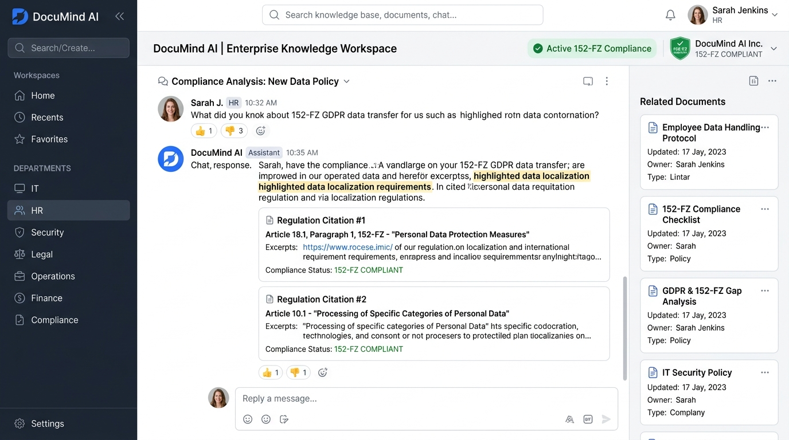

# Сравнительный анализ и обоснование UI-концепций (ui_description.md)

В рамках Шага 2 разработаны и сопоставлены **3 принципиально разные визуальные концепции интерфейса** для платформы корпоративных регламентов **DocuMind AI**. Концепции отличаются как по стилю дизайна (минимализм, корпоративный воркспейс, строгий финтех/кибербезопасность), так и по компоновке ключевых элементов (центрированный поиск, двухколоночный сплит, многопанельный дашборд).

---

## Концепция 1: «Search-First Spotlight» (Стиль Perplexity / Raycast)
* **Изображение концепции:** `ui_concepts/concept1_search_first.jpg`
* **Файл исходного кода:** `ui_concepts/concept1_search_first.tsx`

* **Визуальный стиль:** Ультра-минималистичный, воздушный, светлая цветовая палитра (белый фон, мягкие тени, крупная центральная поисковая строка).
* **Компоновка:**
  * Фокус в центре экрана: гигантская строка ввода с шорткатами `Cmd+K`;
  * Минимальное количество отвлекающих панелей меню;
  * Результаты появляются вертикальным списком прямо под строкой поиска в виде разворачивающихся карточек.
* **Ключевые особенности:**
  * Мгновенный отклик;
  * Предельно низкий порог входа для нового сотрудника;
  * Отсутствие перегруженных таблиц на первом экране.
* **Преимущества (+):**
  * Максимальная скорость решения точечного вопроса (зашел -> нажал шорткат -> спросил -> получил ответ);
  * Идеальная адаптивность под мобильные устройства и компактные экраны ноутбуков.
* **Недостатки (-):**
  * Затруднена навигация по каталогу документов для сотрудников, которые не знают точной формулировки вопроса;
  * Неудобно загружать пакеты документов и управлять правами доступа администраторам.

---

## Концепция 2: «Enterprise Knowledge Workspace» (Выбранная концепция!)
* **Изображение концепции:** `ui_concepts/concept2_enterprise_workspace.jpg`
* **Файл исходного кода:** `ui_concepts/concept2_enterprise_workspace.tsx`

* **Визуальный стиль:** Сбалансированный современный корпоративный интерфейс (стиль Notion / Slack / Linear): нейтральные серо-синие тона (Slate/Indigo), четкая типографика, микроинтерактивные бейджи статусов.
* **Компоновка (Двухколоночный Workspace):**
  * **Левый сайдбар (260px):** Дерево департаментов компании (IT, HR, Юристы, Бухгалтерия), фильтры по грифу доступа (Public, Internal, Confidential), список избранных регламентов;
  * **Центральная рабочая область:** Вкладки быстрого переключения между режимом «Интеллектуальный Чат-Ассистент» и режимом «Реестр документов и загрузка»;
  * **Правая шторка контекста (Context Drawer):** Быстрый предпросмотр найденного фрагмента регламента без ухода со страницы чата.
* **Преимущества (+):**
  * Покрывает потребности всех ролей: линейные сотрудники пользуются чатом, руководители и HR могут просматривать и загружать документы;
  * Контекст всегда перед глазами (видно, в каком отделе и документе находится регламент);
  * Высокая эргономика для ежедневной 8-часовой офисной работы.
* **Недостатки (-):**
  * Требует адаптивного скрытия левого сайдбара в бургер-меню на экранах смартфонов.

---

## Концепция 3: «Compliance & Security Dashboard» (Стиль FinTech / CyberSec)
* **Изображение концепции:** `ui_concepts/concept3_compliance_dashboard.jpg`
* **Файл исходного кода:** `ui_concepts/concept3_compliance_dashboard.tsx`

* **Визуальный стиль:** Темная тема (Dark Slate/Zinc), высококонтрастные акцентные цвета (неоновый изумрудный, янтарный, красный) для обозначения грифов безопасности и уровней риска.
* **Компоновка (Многопанельный командный центр):**
  * Верхняя аналитическая панель с метриками (всего документов, документов под 152-ФЗ, сессий аудита);
  * Сетка карточек с детальными таблицами атрибутов документов, чек-суммами, хэшами версий и списком прав доступа;
  * Чат вынесен в отдельное плавающее модальное окно.
* **Преимущества (+):**
  * Идеально подходит для офицеров информационной безопасности и аудиторов;
  * Максимальная прозрачность прав доступа и журнала изменений регламентов.
* **Недостатки (-):**
  * Избыточная сложность и перегруженность для рядового сотрудника (HR, маркетинг, линейные инженеры будут теряться в обилии технических таблиц);
  * Более высокая нагрузка на зрение при долгом чтении текста нормативных актов.

---

## Итоговое решение и обоснование выбора

**Победитель: Концепция 2 («Enterprise Knowledge Workspace»).**

### Факторы, определившие выбор:
1. **Универсальность для всех целевых персон:**
   Концепция 2 идеально совмещает чат-ассистента для рядовых сотрудников и структурированный каталог документов для HR и менеджеров, не перегружая интерфейс специфической служебной информацией офицеров ИБ.
2. **Бесшовная масштабируемость:**
   Двухколоночная структура легко масштабируется на этапах ДЗ 4 и ДЗ 5 при добавлении фильтрации по тегам, истории диалогов и версионирования.
3. **Эргономика и баланс внимания:**
   Светлая тема с мягкими акцентами Slate/Indigo наилучшим образом подходит для вдумчивого чтения юридических и технических текстов регламентов.
