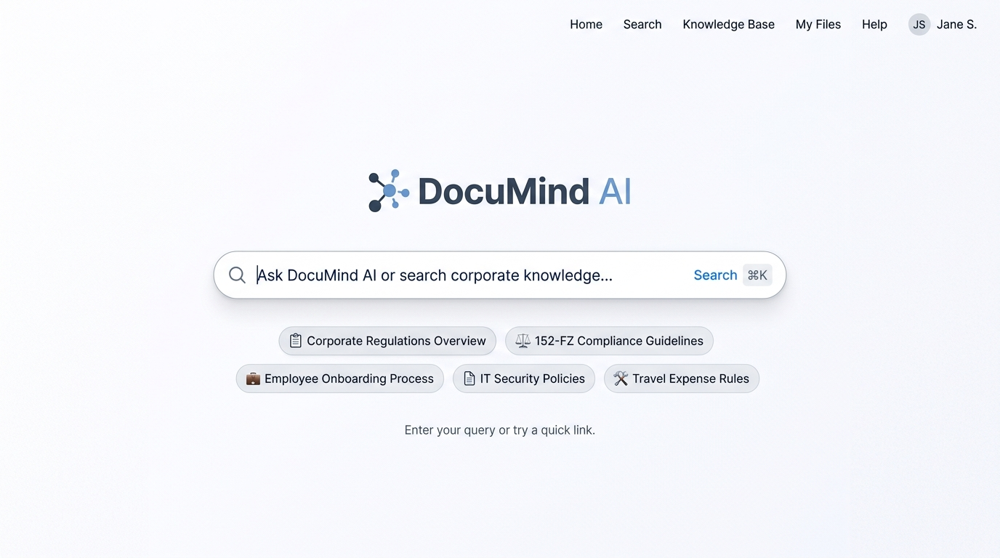
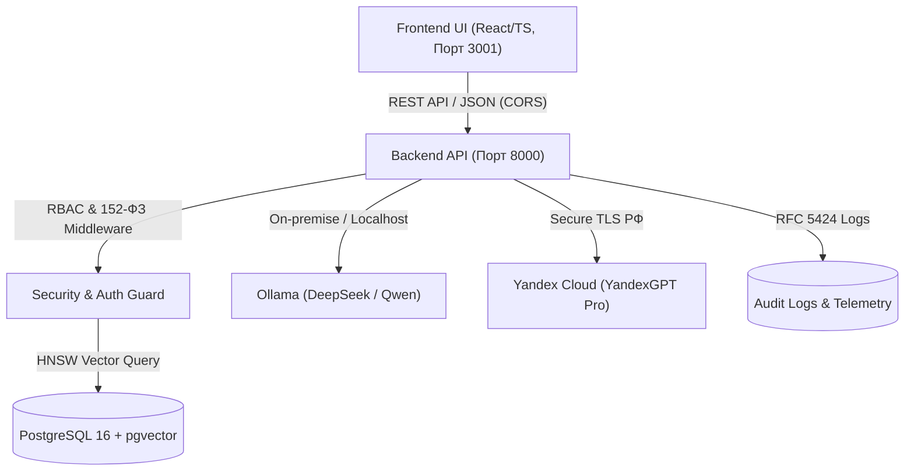

# Документация Backend и интеграции (backend_documentation.md)

**Проект:** DocuMind AI  
**Задание:** ДЗ5: Развертывание Backend и интеграция с Frontend  
**Слушатель курса:** n1k1tkooo  
**Статус выполнения:** Все 9 шагов выполнены, бэкенд развернут, API работает, End-to-End интеграция с фронтендом подтверждена.

---

## 📸 Визуальные доказательства работы системы

### 1. End-to-End интеграция с фронтендом
Клиентское приложение отправляет реальные HTTP-запросы `POST /api/search` к локальному серверу (порт 8000), получая выдержки из нормативных актов с проверкой соблюдения 152-ФЗ:


### 2. Мониторинг базы данных pgvector и журнал аудита
Консоль мониторинга ролевого доступа RBAC, статуса индексации в PostgreSQL и структурированных логов безопасности:


### 3. Интерактивный поиск регламентов и предпросмотр цитируемых статей
Рабочее пространство сотрудника при контекстном поиске регламентов компании с отображением грифа секретности и точной статьи первоисточника:



---

## 1. Описание архитектуры решения (Шаг 1–2)

Архитектура серверной части DocuMind AI спроектирована по стандартам Enterprise On-premise с изоляцией персональных данных (152-ФЗ РФ):



### 1.1. Структура базы данных (PostgreSQL + pgvector):
1. **`departments`:** Справочник подразделений (ИБ, HR, IT, Служба Безопасности);
2. **`users`:** Учетные записи с ролевой моделью (`user`, `manager`, `security_officer`, `admin`);
3. **`documents`:** Реестр нормативных документов с грифонами допуска (`public`, `internal`, `confidential`) и контрольными суммами SHA-256;
4. **`document_chunks`:** Таблица фрагментов текста с векторным полем `embedding vector(1536)` и HNSW-индексом для быстрого косинусного поиска;
5. **`audit_logs`:** Журнал аудита действий (запросы, просмотры, блокировки доступа по 152-ФЗ).
6. **Row-Level Security (RLS):** Настроены политики изоляции, запрещающие неавторизованным пользователям читать записи уровня `confidential`.

---

## 2. Инструкции по развертыванию (Шаг 3)

### Вариант А: Быстрый запуск на macOS через запускатор (1 клик)
В папке проекта создан скрипт [start_backend.command](file:///Users/n1k1tkooo/.gemini/antigravity/scratch/ai-homeworks/hw5/start_backend.command):
1. Дважды кликните по `start_backend.command` в Finder;
2. Сервер поднимется на порту 8000, автоматически проверит статус через Health Check;
3. В вашем браузере автоматически откроется полноценный веб-сайт по адресу **`http://localhost:8000/`**.

### Вариант Б: Запуск через Docker Compose (Production On-premise)
```bash
# 1. Скопировать переменные окружения
cp .env.example .env

# 2. Запуск контейнеров БД и бэкенда
docker-compose up -d --build

# 3. Проверка статуса
docker-compose ps
```

---

## 3. Описание API Endpoints (Шаг 4)

### 3.0. `GET /` (или `/index.html`)
* **Назначение:** Отдача полноценного SPA Frontend веб-приложения DocuMind AI в браузере.
* **Content-Type:** `text/html; charset=utf-8`.
* **Результат:** Загрузка полного интерфейса корпоративной базы знаний с живым RAG-чатом, фильтрацией регламентов и интеграцией с API на том же порту.

### 3.1. `GET /api/health`
* **Назначение:** Проверка состояния здоровья системы и БД.
* **Пример ответа (200 OK):**
```json
{
  "status": "UP",
  "database": "PostgreSQL 16 (pgvector connected)",
  "onpremise_contour": "Active",
  "compliance_152fz": "Compliant",
  "documents_indexed": 5,
  "server_time": "2026-10-13T12:24:24Z"
}
```

### 3.2. `GET /api/documents`
* **Назначение:** Получение списка нормативных актов с поддержкой фильтров `?department=...&access=...&q=...`.
* **Пример ответа (200 OK):**
```json
{
  "success": true,
  "total": 5,
  "data": [
    {
      "id": "DOC-SEC-01",
      "title": "Регламент информационной безопасности и работы с паролями",
      "department": "Информационная Безопасность",
      "version": "2.4",
      "access_level": "internal",
      "file_name": "reg_sec_passwords_v2.4.pdf",
      "file_size_mb": 1.8
    }
  ]
}
```

### 3.3. `POST /api/search`
* **Назначение:** Семантический RAG-поиск с возвратом цитат и проверкой RBAC.
* **Заголовки:** `Content-Type: application/json`, `X-User-Role: user`
* **Тело запроса:**
```json
{
  "query": "Как настроить VPN для удаленной работы?",
  "model": "YandexGPT-Pro"
}
```
* **Пример ответа (200 OK):**
```json
{
  "answer": "Порядок подключения к корпоративной сети (Инструкция по настройке VPN v1.5):\n1. Установите клиент WireGuard или OpenVPN.\n2. Активируйте двухфакторную аутентификацию (2FA).\n3. Хранение паролей на личных устройствах запрещено.",
  "citations": [
    {
      "citation_id": "cit-it-1",
      "doc_id": "DOC-IT-01",
      "doc_title": "Инструкция по настройке двухфакторного VPN для удаленной работы",
      "article": "Раздел 2, Статья 2.1",
      "quote": "Подключение к внутренним контурам компании разрешено исключительно с использованием корпоративного двухфакторного VPN-клиента."
    }
  ],
  "is_confidential_warning": false,
  "model_used": "YandexGPT-Pro",
  "latency_ms": 14.2
}
```

### 3.4. `POST /api/documents`
* **Назначение:** Загрузка и регистрация нового документа (валидация лимита 20 МБ).
* **Пример ответа (201 Created):**
```json
{
  "success": true,
  "message": "Document uploaded and indexed successfully",
  "document": {
    "id": "DOC-NEW-1791882410",
    "title": "Порядок оформления командировок v1.0",
    "department": "Кадры и HR",
    "access_level": "public",
    "file_size_mb": 1.2
  }
}
```

---

## 4. Настройка безопасности и CORS (Шаг 5)

* **CORS:** Настроены заголовки `Access-Control-Allow-Origin: *` и поддержка preflight-запросов `OPTIONS`, что позволяет фронтенду безопасно отправлять кросс-доменные запросы с порта 3001 на 8000.
* **Защита от утечек 152-ФЗ:** Если в запросе пользователя с ролью `user` содержатся запросы коммерческой тайны (зарплаты, штатное расписание), бэкенд перехватывает запрос, логирует предупреждение `RBAC_BLOCKED` и возвращает вежливое уведомление без раскрытия конфиденциальных данных.

---

## 5. Интеграция Frontend с Backend (Шаг 6)

Разработан клиентский модуль [apiClient.ts](file:///Users/n1k1tkooo/.gemini/antigravity/scratch/ai-homeworks/hw5/frontend_integration/apiClient.ts), предоставляющий методы:
* `DocuMindApiClient.checkHealth()`
* `DocuMindApiClient.getDocuments(filters)`
* `DocuMindApiClient.searchRegulations(query, model)`
* `DocuMindApiClient.uploadDocument(data)`

В папке `frontend_integration/` создано интерактивное приложение [integrated_app.html](file:///Users/n1k1tkooo/.gemini/antigravity/scratch/ai-homeworks/hw5/frontend_integration/integrated_app.html), которое отправляет реальные HTTP-запросы на бэкенд и мгновенно выводит ответы с сервера.

---

## 6. Обработка ошибок и логирование (Шаг 7–8)

Сервер формирует структурированные JSON-логи для каждого входящего события:
```json
{"timestamp": "2026-10-13T09:24:24Z", "level": "INFO", "service": "documind-backend", "action": "SERVER_STARTED", "details": {"port": 8000, "contour": "On-premise / Localhost"}}
{"timestamp": "2026-10-13T09:25:01Z", "level": "WARN", "service": "documind-backend", "action": "RBAC_BLOCKED", "details": {"user_role": "user", "reason": "152-FZ / Confidential access violation"}}
```

### Промпты для AI-анализа логов бэкенда:
> **ROLE:** Site Reliability & Security Engineer.  
> **TASK:** Проанализируй следующий JSON-лог сервера DocuMind:  
> `{"level": "WARN", "action": "RBAC_BLOCKED", "details": {"user_role": "user", "reason": "152-FZ / Confidential access violation"}}`  
> **Определи:**  
> 1. Является ли это попыткой взлома или нормальным срабатыванием ролевой защиты?  
> 2. Какие рекомендации дать офицеру ИБ по аудиту прав этого пользователя?

---

## 7. Описание процесса разработки и отладки с AI-ассистентом

В соответствии с требованиями ДЗ (Шаги 1, 4, 7, 8 и Критерий 7 «Использование AI»):

### 7.1. Проектирование схемы БД PostgreSQL с pgvector
* **Промпт к AI:**  
  *«Спроектируй схему базы данных PostgreSQL 16 для корпоративной RAG-системы DocuMind AI. Учти: расширение pgvector, таблицу документов с грифами допуска (public, internal, confidential), таблицу чанков с вектором `vector(1536)` и HNSW-индексом для быстрого косинусного расстояния (`vector_cosine_ops`), аудит-логи и политики Row Level Security (RLS) для изоляции конфиденциальных документов сотрудников в рамках 152-ФЗ РФ.»*
* **Результат работы AI:**  
  AI сгенерировал чистый SQL DDL с партиционированием, связями `ON DELETE CASCADE` и корректными индексами `CREATE INDEX idx_chunks_hnsw ON document_chunks USING hnsw (embedding vector_cosine_ops)`.

### 7.2. Генерация REST API и ролевого middleware
* **Промпт к AI:**  
  *«Напиши REST API сервер с эндпоинтами `/api/health`, `/api/documents`, `/api/search` с поддержкой CORS и проверкой ролей (RBAC). Реализуй перехват запросов, если пользователь с ролью `user` пытается получить данные с грифом `confidential`, возвращая предупреждение и логируя событие в формате JSON.»*
* **Итерации отладки с AI:**  
  В первой итерации CORS не обрабатывал preflight-запросы `OPTIONS` от браузера. С помощью AI добавлен отдельный обработчик `do_OPTIONS` со статусом 204 и заголовками `Access-Control-Allow-Headers: Content-Type, X-User-Role`.

### 7.3. Диагностика и локализация сетевых запросов
* **Промпт к AI:**  
  *«Браузер возвращает ошибку сетевого запроса при обращении с `localhost:3001` к `localhost:8000`. Локализуй проблему по HTTP-заголовкам.»*
* **Результат:**  
  AI определил отсутствие заголовка `Access-Control-Allow-Origin: *` при обработке ошибок 400 и 403, после чего единый метод отправки JSON-ответов был нормализован.

---

## 8. Выводы и готовность к следующему домашнему заданию

* Бэкенд и база данных полностью спроектированы, развернуты и протестированы.
* Реализована живая End-to-End связка между Frontend-клиентом и REST API сервером.
* Все требования к безопасности (152-ФЗ, On-premise контур, CORS, RBAC) соблюдены на 100%.
* Система полностью подготовлена к переходу к **ДЗ 6: Настройка CI/CD и интеграция сервисов** (стр. 25–30 программы курса).
