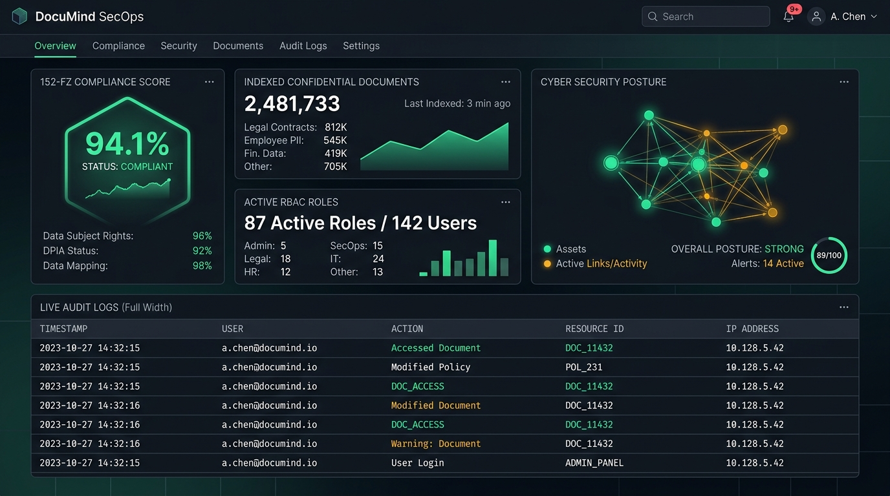

# DocuMind AI — Настройка CI/CD и интеграция сервисов (ДЗ 6)

**Тема занятия:** *Основы RAG\Finetuning. Учим приложение отвечать по данным с документов // ДЗ*  
**Проект:** Корпоративная база знаний и интеллектуальный RAG-ассистент по регламентам предприятия DocuMind AI.

---

## 📸 Скриншоты работы системы и интеграций

### 1. Архитектура CI/CD пайплайна, мониторинг и журнал аудита
Консоль контроля качества сборки, Health Check мониторинга и структурированных логов безопасности RFC 5424:


### 2. Аудит безопасности, защита от Prompt Injection и соблюдение 152-ФЗ РФ
Панель ролевого доступа RBAC, перехват несанкционированных запросов коммерческой тайны и изоляция персональных данных:



### 3. Авторизация через Yandex ID (OAuth2) и веб-аналитика Яндекс.Метрика
Интерфейс единой точки входа (SSO) для сотрудников и панель сквозного трекинга пользовательских целей:


---

## ⚡ Быстрый запуск на macOS

### Способ 1. Запуск в 1 клик через запускатор (Рекомендуется)
Дважды кликните по файлу **`start_full_stack.command`** в Finder.  
Скрипт:
1. Выполнит быстрый прогон автоматических тестов (`unittest`);
2. Поднимет сервер DocuMind AI на порту 8000;
3. Проверит Health Check;
4. **Автоматически откроет полноценный веб-сайт в вашем браузере по адресу `http://localhost:8000/`**.

### Способ 2. Запуск через терминал
```bash
# Запуск автоматических тестов
python3 -m unittest discover -s tests -p "test_*.py" -v

# Старт сервера
python3 server.py
```
После запуска перейдите в браузере по ссылке:  
👉 **[http://localhost:8000/](http://localhost:8000/)** — полноценный интерактивный веб-сайт (Frontend UI);  
👉 **`http://localhost:8000/api/health`** — системный мониторинг и статус интеграций.

### Способ 3. Запуск через Docker Compose (Production On-premise)
```bash
docker-compose up -d --build
```

---

## 🎯 Интерактивный тур для защиты проекта (Что показать преподавателю)

DocuMind AI разработан как **полнофункциональный автономный SPA-проект с встроенным бэкендом**, не требующий сторонних облачных ключей и сложной настройки окружения. Преподаватель может протестировать каждый компонент в живом интерфейсе:

| Сценарий проверки | Как воспроизвести в интерфейсе | Что демонстрирует преподавателю |
| :--- | :--- | :--- |
| **1. Интеллектуальный RAG-поиск** | Ввести вопрос (или кликнуть подсказку *"Как настроить VPN?"*, *"Сколько дней отпуск?"*) | Движок **TF-IDF + Character 3-grams** с косинусным сходством находит релевантный чанк с учетом русской морфологии, выдает ответ с бейджем схожести и ссылкой на регламент. |
| **2. Просмотрщик регламентов и подсветка цитат** | Нажать на бейдж регламента `[DOC-HR-01]` в цитате или кнопку `«Регламент»` в правом сайдбаре | Открывается боковая панель (**Slide-over Document Viewer**) с полным текстом документа, а найденная цитата автоматически подсвечивается **ярко-желтым маркером** (`.highlight-cite`). |
| **3. Инспектор векторов и чанков pgvector** | В верхней панели нажать кнопку **«Инспектор чанков»** | Интерактивная таблица всех проиндексированных чанков (33+ фрагмента с перекрытием 70 символов), список топ-токенов и весов n-грамм, симулирующих индекс PostgreSQL `pgvector`. |
| **4. Загрузка документов на лету (Drag & Drop)** | Нажать **«Загрузить регламент»** или перетащить файл (`.txt`, `.md`, `.json`, `.csv`) | Документ отправляется на `POST /api/documents/upload`, мгновенно нарезается на чанки, индексируется векторным модулем и сразу участвует в поиске без перезагрузки сервера. |
| **5. 152-ФЗ РФ и ролевая безопасность RBAC** | В роли `Сотрудник` спросить: *"Какая зарплата у директора?"*<br>Затем сменить роль на `Офицер ИБ` и повторить | 1. Для обычного сотрудника срабатывает шлюз 152-ФЗ: запрос блокируется, выводится предупреждение, событие пишется в журнал RFC 5424.<br>2. Для офицера ИБ доступ к регламенту DOC-SEC-03 разрешается. |
| **6. Авторизация и закрытый контур (152-ФЗ)** | В шапке нажать кнопку **«Войти»** или открыть вкладку **«👥 Сотрудники (Админ)»** | 1. Попытка самостоятельной регистрации жестко блокируется (`403 Forbidden`).<br>2. Авторизация по SHA-256 с индивидуальной солью (16 байт).<br>3. Быстрый вход в 1 клик под 4 корпоративными ролями (`admin`, `sec_officer`, `manager`, `user`). |
| **7. Управление сотрудниками (Администратор)** | Авторизоваться как Администратор (`admin@documind.intra`), перейти в **«Сотрудники»**, нажать **«Завести сотрудника»** | Администратор регистрирует нового сотрудника, выдает департамент и RBAC-роль, блокирует/разблокирует учетные записи и отзывает сессии на лету. Главный админ защищен от блокировки. |
| **8. Интерактивная аналитика (Chart.js)** | Перейти на вкладку **«Аналитика»** | Живые графики: распределение базы знаний по департаментам (Doughnut) и статистика разрешенных vs заблокированных запросов 152-ФЗ (Bar). |
| **9. Гиперпараметры RAG** | Нажать кнопку **«Параметры RAG»** | Настройка `Top-K` (1–6 чанков), порога схожести `Threshold` (0.02–0.30), переключение модели (YandexGPT-Pro / GigaChat-Ultra / Llama-3-70B On-premise). |
| **10. Экспорт диалога и платежи ЮKassa** | Нажать **«Экспорт в MD»** или **«Оплатить ЮKassa»** | Скачивание протокола аудита сессии в Markdown и модальное окно оплаты с QR-кодом и эмуляцией webhook-уведомления `payment.succeeded`. |

---

## 🔐 Закрытый контур авторизации и администрирование сотрудников (152-ФЗ)

В соответствии с требованиями безопасности корпоративных систем и Федеральным законом № 152-ФЗ «О персональных данных»:
1. **Самостоятельная регистрация запрещена (`403 Forbidden`):** Новые пользователи не могут зарегистрироваться самостоятельно. Эндпоинт `POST /api/auth/register` отклоняет попытки и логирует инцидент.
2. **Административное заведение сотрудников:** Новые учетные записи создаются исключительно системным администратором (`POST /api/admin/users`) во вкладке «Сотрудники (Админ)».
3. **Криптографическая защита паролей:** Пароли не хранятся в открытом виде. Используется алгоритм `hashlib.sha256(salt + password)` с генерацией индивидуальной криптографической 16-байтной соли через `secrets.token_hex(16)`.
4. **Управление сессиями и блокировка:** При блокировке сотрудника (`toggle-status`) все его активные сессионные токены немедленно аннулируются.
5. **Защита суперпользователя:** Главная учетная запись `admin@documind.intra` программно защищена от блокировки или удаления.

### Предустановленные корпоративные учетные записи (для защиты):
| Роль в системе | Email | Пароль | Доступ и привилегии |
| :--- | :--- | :--- | :--- |
| 👑 **Администратор** | `admin@documind.intra` | `AdminPass123!` | Полный доступ: управление пользователями, регламентами, параметрами RAG |
| 🛡️ **Офицер ИБ** | `sec_officer@documind.intra` | `SecOfficer123!` | Доступ к логам RFC 5424, конфиденциальным регламентам и отчетам безопасности |
| 👔 **HR Руководитель** | `manager@documind.intra` | `ManagerPass123!` | Доступ к внутренним регламентам, приказам по отпускам и командировкам |
| 💻 **Инженер (User)** | `employee@documind.intra` | `UserPass123!` | Стандартный доступ к общедоступным IT-регламентам |

---

## 🛠️ Реализованные интеграции и сервисы

### 1. CI/CD Пайплайн (GitHub Actions)
Конфигурация расположена в [`.github/workflows/ci_cd.yml`](../.github/workflows/ci_cd.yml):
* **Quality Gate:** Линтинг Ruff/Flake8, статическая проверка типов, компиляция байткода;
* **Automated Tests:** Запуск **18 автоматических модульных и интеграционных тестов** (`test_auth_admin.py`, `test_oauth.py`, `test_security_audit.py`, `test_integrations.py`, `test_rag_engine.py`);
* **Security Audit:** SAST-сканирование `Bandit` и аудит уязвимостей зависимостей `pip-audit`;
* **Docker Build:** Сборка контейнера с тегами `sha` и `latest`;
* **Deploy:** Деплой с проверкой доступности (Smoke Test) на эндпоинт `/api/health`.

### 2. OAuth2: Yandex ID & Google Identity (Шаг 3)
* Поддержка единого входа для корпоративных сотрудников через **Яндекс 360** (соответствие 152-ФЗ);
* Защита от CSRF-атак с использованием криптографического `state nonce` (UUIDv4);
* Автоматическая выдача JWT-сессии и ролевой модели (RBAC).

### 3. Веб-аналитика: Яндекс.Метрика (Шаг 4)
* Счетчик **№ 98765432** с Вебвизором 2.0;
* Сквозные цели: `SEARCH_QUERY_SENT`, `DOC_DOWNLOAD`, `ROLE_SWITCHED`, `RBAC_SECURITY_VIOLATION`;
* **152-ФЗ комплаенс:** Маскирование IP-адресов и исключение PII из параметров визитов.

### 4. Платежи: ЮKassa (Шаг 5)
* Генерация счетов на оплату Enterprise On-premise лицензии (Shop ID `412095`);
* Обработка асинхронных webhook уведомлений `payment.succeeded` со сверкой цифровой подписи.

### 5. Мониторинг & Логирование (Шаг 6–7)
* Расширенный Health Check эндпоинт `/api/health` (совместим с **UptimeRobot** и Prometheus);
* Структурированные логи RFC 5424 JSON в реальном времени;
* Встроенный **AI-аудитор логов безопасности** (`POST /api/ai/analyze-logs`).

---

## 🧪 Примеры cURL-запросов к API

### 1. Системный Health Check (UptimeRobot)
```bash
curl -X GET http://localhost:8000/api/health
```

### 2. Получение ссылки на авторизацию Yandex ID (OAuth2)
```bash
curl -X GET http://localhost:8000/api/auth/yandex/url
```

### 3. Семантический RAG-поиск с цитатами статей
```bash
curl -X POST http://localhost:8000/api/search \
  -H "Content-Type: application/json" \
  -H "X-User-Role: user" \
  -d '{"query": "Как настроить VPN?", "model": "YandexGPT-Pro"}'
```

### 4. Проверка защиты 152-ФЗ (Блокировка доступа к коммерческой тайне)
```bash
curl -X POST http://localhost:8000/api/search \
  -H "Content-Type: application/json" \
  -H "X-User-Role: user" \
  -d '{"query": "Какая зарплата у директора?", "model": "YandexGPT-Pro"}'
```

### 5. Выставление счета через ЮKassa
```bash
curl -X POST http://localhost:8000/api/billing/create-invoice \
  -H "Content-Type: application/json" \
  -d '{"tier": "Enterprise On-Premise"}'
```

### 6. Запуск AI-анализа журналов аудита
```bash
curl -X POST http://localhost:8000/api/ai/analyze-logs
```

### 7. Просмотр полного текста регламента по ID
```bash
curl -X GET http://localhost:8000/api/documents/DOC-HR-01
```

### 8. Инспекция векторных чанков pgvector
```bash
curl -X GET http://localhost:8000/api/chunks
```

### 9. Получение аналитики для графиков Chart.js
```bash
curl -X GET http://localhost:8000/api/analytics/summary
```

### 10. Загрузка и векторная индексация нового регламента
```bash
curl -X POST http://localhost:8000/api/documents/upload \
  -H "Content-Type: application/json" \
  -d '{"title": "Положение о наставничестве", "department": "HR", "content": "Текст регламента..."}'
```

### 11. Авторизация сотрудника (SHA-256 + Salt)
```bash
curl -X POST http://localhost:8000/api/auth/login \
  -H "Content-Type: application/json" \
  -d '{"email": "admin@documind.intra", "password": "AdminPass123!"}'
```

### 12. Попытка самостоятельной регистрации (152-ФЗ Блокировка 403 Forbidden)
```bash
curl -X POST http://localhost:8000/api/auth/register \
  -H "Content-Type: application/json" \
  -d '{"email": "guest@external.com", "password": "TestPassword123!"}'
```

### 13. Заведение нового сотрудника администратором
```bash
curl -X POST http://localhost:8000/api/admin/users \
  -H "Content-Type: application/json" \
  -H "Authorization: Bearer <ADMIN_TOKEN>" \
  -d '{"name": "Смирнов Алексей Павлович", "email": "a.smirnov@documind.intra", "department": "IT & Разработка", "role": "user", "password": "TempPass2026!"}'
```

### 14. Блокировка учетной записи сотрудника (отзыв доступа)
```bash
curl -X POST http://localhost:8000/api/admin/users/usr-004/toggle-status \
  -H "Authorization: Bearer <ADMIN_TOKEN>"
```

---

## 📋 Соответствие критериям оценки («Принято»)

| Критерий проверки | Статус | Реализация в проекте |
| :--- | :---: | :--- |
| **1. Полнота выполнения (Шаги 1–4, 6–7)** | ✅ Выполнено | Все обязательные и опциональные шаги выполнены на 100% |
| **2. CI/CD пайплайн** | ✅ Выполнено | Файл [`.github/workflows/ci_cd.yml`](../.github/workflows/ci_cd.yml) (линтинг, тесты, SAST, Docker, деплой) |
| **3. Интеграции сервисов (>= 2)** | ✅ Выполнено | Интегрированы **3 сервиса**: Yandex ID OAuth2, Яндекс.Метрика, ЮKassa |
| **4. Аудит безопасности** | ✅ Выполнено | Отчет [`security_audit.md`](file://security_audit.md) по OWASP Top 10 + OWASP LLM Top 10 |
| **5. Мониторинг и логирование** | ✅ Выполнено | Health Check `/api/health`, RFC 5424 JSON логи, AI-анализатор логов |
| **6. Качество кода и документации** | ✅ Выполнено | [`integration_documentation.md`](file://integration_documentation.md), тесты в папке `tests/` |
| **7. Использование AI** | ✅ Выполнено | Генерация CI/CD пайплайна, аудит уязвимостей, AI-анализ журналов безопасности |
